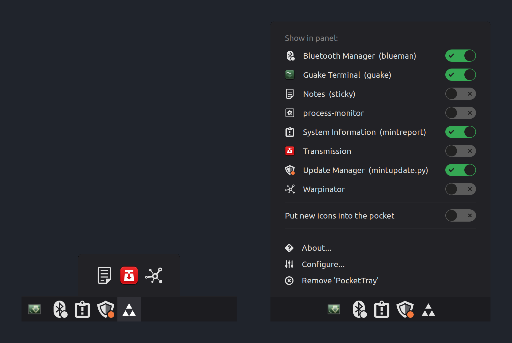

# PocketTray

**A system tray with a pocket for the icons you rarely need.**

Cinnamon's panel fills up with tray icons: updaters, screenshot tools, sync
clients, chat apps. PocketTray keeps the ones you use every day in the panel
and tucks the rest into a small pocket. One click (or a hover) opens it, and
the icons inside behave exactly as they would in the panel.



*Left: the pocket open above the panel. Right: the menu that decides which icon goes where, with one switch per icon.*

## Features

- **One applet for both tray systems.** Replaces Cinnamon's *System Tray* and
  *XApp Status Applet*, and shows legacy X11 icons as well as modern
  StatusNotifier and XApp icons (Electron, Qt, KDE, screen-recording indicator).
- **Sorting with a switch.** Right-click PocketTray and switch each icon
  between the panel and the pocket. Nothing else changes.
- **Open on click or hover**, with a keyboard shortcut if you prefer.
- **Readable pocket.** Icons only, icons with application names, or icons
  with their current status text, so you can see at a glance what a program
  is doing.
- **New icons can go straight into the pocket**, so the panel stays clean
  when you install a new program. Off by default.
- **Changed icons can show up briefly in the panel** when a status icon
  changes its picture or label, for example on a new message. Off by default.
- **Available in German**, with English as the base language.

## Installation

Two ways, both give the same applet:

- **Cinnamon Spices** (per user): *System Settings → Applets → Download*, once
  PocketTray is listed there. Until then, install it by hand as described under
  [Development](#development).
- **Debian package** (system-wide, updated by APT): take `pockettray_<version>_all.deb`
  from the [latest release](https://github.com/be-spex/PocketTray/releases/latest) and run
  `sudo apt install ./pockettray_*_all.deb`. A copy from Spices in your home
  directory takes precedence over the package.

After installing:

1. Remove *System Tray* and *XApp Status Applet* from the panel. If one of
   them is still there, PocketTray removes itself and shows a notification
   instead of displaying icons twice.
2. Add *PocketTray* to the panel.
3. Right-click it and switch the icons you want to keep out of the pocket.

Usage details and all settings are described in the
[applet README](PocketTray@spex/README.md).

## Compatibility

Developed and tested on Linux Mint 22.3 with Cinnamon 6.6.9 on a horizontal
panel.

## Development

The applet lives in [`PocketTray@spex/`](PocketTray@spex/), in the layout used
by Cinnamon Spices. To run a development copy, link it into the applet directory:

```bash
git clone https://github.com/be-spex/PocketTray.git
ln -s "$PWD/PocketTray/PocketTray@spex/files/PocketTray@spex" \
      ~/.local/share/cinnamon/applets/PocketTray@spex
```

- Reload after code changes:
  `dbus-send --session --dest=org.Cinnamon --type=method_call /org/Cinnamon org.Cinnamon.ReloadXlet string:'PocketTray@spex' string:'APPLET'`
- Logs: Looking Glass (`Alt+F2`, `lg`) or `~/.xsession-errors`, lines start with `PocketTray:`
- Translations: `cinnamon-xlet-makepot PocketTray@spex/files/PocketTray@spex` updates the
  template, `cinnamon-xlet-makepot -i PocketTray@spex/files/PocketTray@spex` installs the
  `.po` files locally

### Architecture

All code is in `PocketTray@spex/files/PocketTray@spex/`:

| File | Responsibility |
|---|---|
| `applet.js` | Cinnamon lifecycle, settings, wiring of the modules below |
| `lib/xembedHost.js` | legacy X11 tray icons (`Main.statusIconDispatcher`) |
| `lib/xappHost.js` | XApp/StatusNotifier icons (`XApp.StatusIconMonitor`) |
| `lib/xappStatusIcon.js` | a single XApp icon and the screen-recording indicator |
| `lib/hiddenList.js` | which icon ids belong into the pocket |
| `lib/pocketButton.js` | the pocket button and its icon |
| `lib/pocket.js` | the popup holding the hidden icons, click and hover |
| `lib/iconMenu.js` | context menu with one switch per icon |
| `lib/appInfo.js` | launcher entry, display name, icon and tooltip text of an application |
| `lib/rivalGuard.js` | steps back when another tray applet is enabled |
| `lib/i18n.js` | translations |

A host receives an icon, `applet.placeIcon()` puts it into the panel or the
pocket according to the hidden list, `applet.iconsChanged()` shows or hides
the pocket button. Each file starts with a comment describing its role and
the interface it expects from its owner.

Modules in `lib/` are loaded with Cinnamon's `require()`; paths are relative
to the applet directory, also inside `lib/`, and each module lists its exports
in `module.exports`. The classic per-applet importer
(`imports.ui.appletManager.applets[uuid]`) is avoided on purpose: GJS keeps its
modules until Cinnamon restarts, so after an update the new `applet.js` would
run with the old modules. `require()` notices changed files (it caches by file
size, so an edit that keeps the size unchanged needs a Cinnamon restart).
`require()` is deprecated as of Cinnamon 6.8; switch to its replacement once
that version can be tested.

## Credits and license

Based on `systray@cinnamon.org` and `xapp-status@cinnamon.org` from
[linuxmint/cinnamon](https://github.com/linuxmint/cinnamon), licensed under
GPL-2.0-or-later. PocketTray is distributed under the same license.
